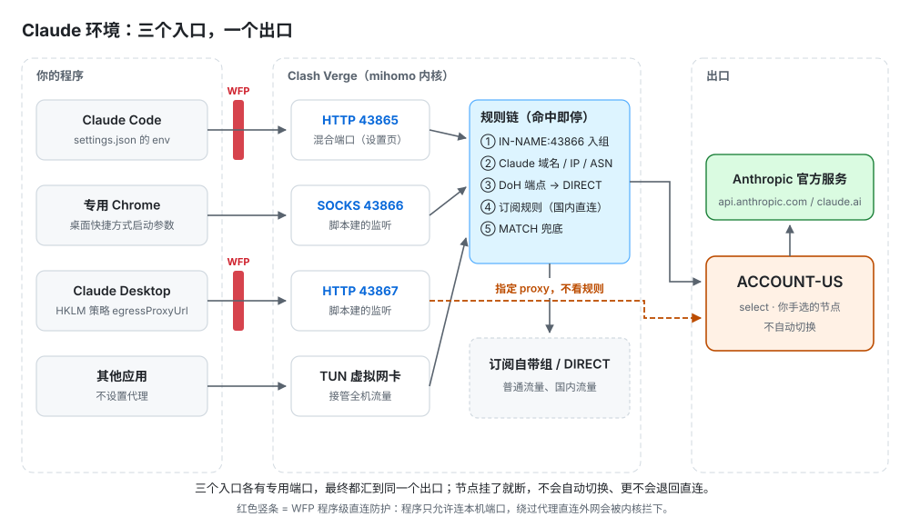

# Claude 环境分享版

让 **Claude Code**、**Claude Desktop** 和**专用 Chrome** 走同一条干净、固定的代理出口；出口不通就断网，绝不偷偷直连。

[](https://github.com/xgz123-wq/claude-env-share/stargazers)


[](LICENSE)



> 2026-10-01 从一台稳定运行的 Windows 机器整理，之后随原机器维护同步（见[提交记录](https://github.com/xgz123-wq/claude-env-share/commits/master)）。已去掉账号别名、出口 IP 和本机状态文件。

## 目录

- [适用条件](#适用条件)
- [快速上手](#快速上手)
- [端口说明](#端口说明)
- [工作原理](#工作原理)
- [日常使用](#日常使用)
- [常见问题](#常见问题)
- [目录结构](#目录结构)
- [边界与许可](#边界与许可)

## 适用条件

| 项 | 要求 |
|---|---|
| 系统 | Windows 10 / 11 |
| 命令行 | PowerShell 7（命令是 `pwsh`） |
| 代理客户端 | Clash Verge Rev（mihomo 内核），已导入你自己的订阅 |
| 浏览器 | Google Chrome（只在建专用浏览器时需要） |
| AI 工具 | Claude Code、Claude Desktop 的 Code 标签页或 Codex，任选其一，用来执行部署 |

其他代理客户端（Clash for Windows、v2rayN 等）和 macOS 不在支持范围内。

## 快速上手

**1. 把混合端口改成 `43865`**

打开 Clash Verge Rev，左侧点「设置」，在「Clash 设置」区找到「端口设置」，把混合代理端口改成 `43865` 并保存。Verge 默认是 `7897`，这套配置的脚本统一按 `43865` 写，不改的话 Claude Code 会连不上。原因和自查方法见[端口说明](#端口说明)。

**2. 让 AI 按 AGENTS.md 部署**

用 AI 工具把这个文件夹当项目打开，发一句：

```text
按 AGENTS.md 帮我在这台机器上部署 Claude 环境
```

AI 会先做端口预检，再逐步配置 Clash、系统、三个程序，每步先说明要改什么。下面几件事 AI 替不了，要你亲手做：

- **选节点**：在 Verge 的 `ACCOUNT-US` 组里手选一个节点，节点质量由你判断。
- **点 UAC**：安装直连防护、写系统策略时弹出的管理员确认，点「是」。
- **登录账号**：在专用 Chrome 和 Claude Desktop 里登录你的 Claude 账号。
- **看检测站**：部署完后肉眼核对出口、DNS、WebRTC、IPv6、语言、时区。

**3. 跑一键总检验收**

```powershell
pwsh -NoProfile -File docs\配置\Claude环境\Claude环境一键总检.ps1
```

要求 `FAIL = 0`。部署没做完时会有几项预期内的报错，对照表见[首次打开会看到的报错](docs/配置/Claude环境/README.md#首次打开会看到的报错)。

## 端口说明

这套配置用 3 个本机端口，分别给 3 个程序用。每个程序只走自己那个端口，端口不通就直接失败，不会退回直连。

### 原机器的实际配置

以下是整理这份分享包的那台机器上，Clash Verge Rev 的实测值：

| 端口 | 是谁设的 | 给谁用 | 协议 |
|---|---|---|---|
| `43865` | Verge「端口设置」里的**混合代理端口**，从默认的 `7897` 手动改成 | Claude Code CLI、VS Code 插件 | HTTP + SOCKS |
| `43866` | 全局扩展脚本新开的监听端口 | 专用 Chrome | SOCKS5 |
| `43867` | 全局扩展脚本新开的监听端口 | Claude Desktop | HTTP |
| `7898` / `7899` | Verge 自带的 SOCKS 端口和 HTTP 端口 | 这套配置不用，保持默认即可 | — |

- **`43865` 要你手动改**：它是 Verge 自己的设置项，每台机器默认值不同，所以部署前必须改成 `43865`。
- **`43866` / `43867` 不用改**：它们由全局扩展脚本自动创建，在 Verge 设置界面里看不到，只能用下面的命令查。
- **端口记在部署清单里**：部署最后一次一键总检会从 Clash 读出三个端口，写进 `%LOCALAPPDATA%\ClaudeNetworkGuard\部署清单.json`；脚本和环境卫士都按这份清单取值，之后改端口只在 Clash 改、再跑一次总检。

### 在你的机器上自查

在 PowerShell 7 里运行：

```powershell
# 1. 看 Verge 当前的混合端口，应为 43865
Select-String "$env:APPDATA\io.github.clash-verge-rev.clash-verge-rev\verge.yaml" -Pattern '^verge_mixed_port'

# 2. 看三个端口被谁占用
Get-NetTCPConnection -State Listen -LocalPort 43865,43866,43867 -ErrorAction SilentlyContinue |
  Select-Object LocalPort, @{n='Process';e={(Get-Process -Id $_.OwningProcess).ProcessName}}
```

| 时机 | 第 2 条命令的正常结果 |
|---|---|
| 部署前 | 只有 `43865` 显示 `verge-mihomo`（改完混合端口后）；`43866` / `43867` 没有输出 |
| 部署后 | 三个端口都显示 `verge-mihomo` |

### 端口被占用怎么办

如果部署前 `43866` 或 `43867` 已被别的程序占用，先关掉那个程序或改它的端口，再部署。

不建议改这套配置的端口号：端口写在 Clash 脚本、Claude Code 设置、Desktop 策略、快捷方式和检查脚本里，改一个就要同步几十处。确实要改时，按 Skill 的 [SOP-3 改端口流程](.agents/skills/claude-safe-network/references/03-变更与回滚SOP.md)操作，先按 SOP 里的 grep 命令列出所有出现位置。

## 工作原理

| 层 | 做了什么 |
|---|---|
| Clash | 全局扩展脚本新建 `ACCOUNT-US` 组，Claude 域名、IP 段和 `43866` / `43867` 的流量都进这个组；国内流量照常直连 |
| 系统 | 网卡、Clash、DNS 三层关闭 IPv6；开 TUN、关系统代理；防火墙阻断直连 Anthropic 官方 IP 段 |
| 程序 | Claude Code 的代理环境变量、专用 Chrome 的启动参数、Desktop 的 HKLM 策略都写死各自的端口；直连防护（WFP）在内核层拦截这些程序绕过代理的出站 |

`ACCOUNT-US` 是手选组：节点挂了就停在那里失败，不会自动换节点，也不会退回直连。

想了解细节，按这个顺序看：

1. [架构讲解.html](docs/配置/Claude环境/说明/架构讲解.html)：每个配置点的含义，出问题定位到哪一层（下载后双击打开）。
2. [规则顺序与三道硬拦](docs/配置/Claude环境/README.md#规则匹配顺序)：规则怎么匹配、系统层拦什么。
3. [DNS 分层说明](docs/配置/Claude环境/说明/DNS分层说明.md)、[账号浏览器](docs/配置/Claude环境/说明/账号浏览器.md)：DNS、IPv6 和专用 Chrome 的每个参数。

## 日常使用

| 要做什么 | 怎么做 |
|---|---|
| 每天开工前检查 | 双击桌面「Claude-环境一键总检」，再按[日常使用](docs/配置/Claude环境/说明/日常使用.md)做网页验收 |
| 看三端要不要更新 | `pwsh -NoProfile -File docs\配置\Claude环境\Desktop防护\更新三端Claude.ps1 -Action Check` |
| 更新三端 | 退出全部 Claude 后双击桌面「Claude-三端更新」，细节见[更新维护说明](docs/配置/Claude环境/Desktop防护/更新维护说明.md) |

桌面图标在部署第 7 步创建。Claude Desktop 的自动更新保持关闭，由你手动触发更新。

## 常见问题

<details>
<summary><b>需要一直开着 Clash 吗？</b></summary>

需要。它是唯一出口，关了三个程序都会断网，这是设计如此。
</details>

<details>
<summary><b>突然上不去 Claude，先查什么？</b></summary>

1. Verge 里 `ACCOUNT-US` 选的节点是否还能用。
2. Clash 是否在运行、TUN 是否开着。
3. 跑[端口自查](#在你的机器上自查)，看三个端口是否都由 `verge-mihomo` 监听。

配置写对了不会突然失效，多半是节点挂了或 Clash 停了。
</details>

<details>
<summary><b>国内网站会走代理吗？</b></summary>

不会。订阅原有的 `GEOSITE,cn` / `GEOIP,CN` 规则照常直连，Claude 规则只是排在它们前面。
</details>

<details>
<summary><b>换节点、换订阅要重新配置吗？</b></summary>

不用。Claude 的专用组、置顶规则和两个监听端口都在全局扩展脚本里，跟订阅无关。换节点或导入新订阅后，回到 `ACCOUNT-US` 重新手选一个节点，再跑一次总检即可。

换订阅不会改混合端口；如果重装或重置过 Verge，跑一次[端口自查](#在你的机器上自查)确认它还是 `43865`。
</details>

<details>
<summary><b>一个专用浏览器能登几个账号？</b></summary>

一个。多账号就多建几个专用浏览器。不要用 Chrome 自带的「添加用户」，它共用同一个数据目录，达不到隔离。
</details>

<details>
<summary><b>什么是直连防护（WFP）？</b></summary>

WFP 是 Windows 内核自带的网络过滤框架。这套配置用它给指定程序加规则：只允许连本机回环（也就是代理），想直接连外网就被内核拦下。防火墙规则拦的是目标 IP，WFP 拦的是发起程序，所以更严。

程序路径、文件哈希、规则 GUID 每台机器都不同，分享包里只有[示例文件](docs/配置/Claude环境/Desktop防护/应用过滤目标.示例.json)，部署时在本机生成。
</details>

## 目录结构

```text
Claude环境分享版/
├─ AGENTS.md                 给 AI 的部署步骤和维护约束
├─ CLAUDE.md                 一行 @AGENTS.md，让 Claude 读同一份约定
├─ docs/配置/Claude环境/     日常使用的脚本和说明（桌面图标指向这里）
│  ├─ Clash/                 全局扩展脚本、通道验证、官方域名复核
│  ├─ Desktop防护/           直连防护、43867 通道、三端更新
│  ├─ 工具/                  完整性检查与一次性安装、回滚工具
│  ├─ 说明/                  架构讲解和四份专题说明
│  └─ assets/                架构图与图标
└─ .agents/skills/
   ├─ claude-safe-network/   排障说明（命令指回 docs）
   └─ claude-maintenance/    Desktop / CLI 更新流程
```

脚本按「脚本目录往上 3 层 = 项目根」定位，不要改目录名或层级。各文件用途见 [docs 总览](docs/配置/Claude环境/README.md)。

## 边界与许可

- **只保证**：出口固定、不泄漏、不绕过代理。
- **不做**：规避检测、伪装身份、绕过 Anthropic 的地区或账号规则。使用前请确认你所在地区和付款方式符合 Anthropic 条款。
- **许可**：[MIT License](LICENSE)。脚本会改动系统网络和防火墙设置，风险由使用者自负。

问题和建议请提 [Issue](https://github.com/xgz123-wq/claude-env-share/issues)；如果它帮你省了排障时间，欢迎点个 Star。
