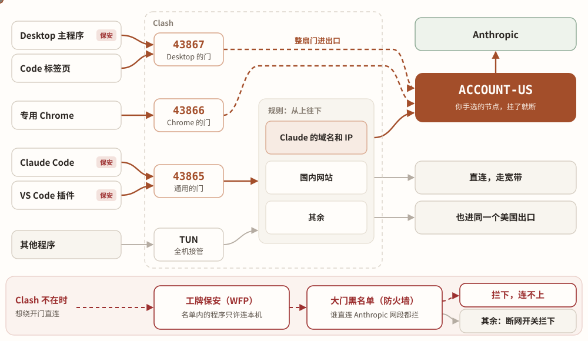

# Claude 环境分享版

让 Claude（桌面 App、Claude Code、网页）始终从同一个美国出口上网；国内网站照常直连；代理断了整台电脑就断网，绝不用你的国内 IP 偷偷连出去。

## 这是什么

一套已经在一台 Windows 电脑上长期跑着、实测过的配置，加上一份给 AI 用的[部署提示词](docs/配置/Claude环境/部署提示词.md)。你不用看懂技术细节：把提示词交给 AI，它照着配好，再自己跑验收，证明配好了。

思路来自一篇经验帖：国内网站名单以内的直连，名单以外的全部走海外出口，再加一个「代理不在就断网」的开关。这里在它的基础上多加了几道防线，并且都有测试脚本。

## 防什么，不防什么

**防这些**：
- **只给 claude.ai 配了代理，漏了其他域名**：Claude 调用的第三方服务（遥测、错误上报）也会被送进海外出口。
- **节点挂了或代理闪断时回落直连**：出口组里没有「直连」这个选项，节点挂了就是断网。
- **Clash 崩了、被退出、虚拟网卡掉了**：断网开关让整台电脑上不了外网，只剩局域网能通。
- **Clash 被误切到全局或直连模式**：Claude 桌面 App 和专用浏览器的端口写死在出口组上，不跟着模式变。

**不防这些**：
- **账号本身的风险**：不做规避检测、伪装身份，也不绕过 Anthropic 的地区或账号规则。使用前请确认你的地区和付款方式符合 Anthropic 条款。
- **已知边界**：几处小范围的例外，比如 Clash 切到直连模式时 Claude Code 会跟着直连。这些已经评估过并接受，清单在[部署提示词「已接受的风险」](docs/配置/Claude环境/部署提示词.md)。

## 怎么用

**你要先准备好**：Windows 10/11、PowerShell 7、Clash Verge Rev（已导入你自己的订阅）、一个能执行命令的 AI 工具（Claude Code、Codex 等）。Mac 也能用这份提示词，但本仓库没有在 Mac 上实测过。

1. **改一个端口**：打开 Clash Verge Rev →「设置」→「Clash 设置」→「端口设置」，把混合代理端口改成 `43865` 并保存。
2. **交给 AI**：用 AI 工具把这个文件夹当项目打开，把[部署提示词](docs/配置/Claude环境/部署提示词.md)里的代码块整段发给它。它会先只读体检，一次问完你几个问题，你同意了才动手。
3. **这几件事 AI 替不了，要你亲手做**：
   - **选节点**：在 Clash Verge 的 `ACCOUNT-US` 组里手选一个美国节点。
   - **点 UAC**：弹出管理员确认时点「是」。
   - **登录账号**：在专用浏览器和 Claude 桌面 App 里登录。
   - **配合演练**：断网演练时，照提示去关、开 Clash。

## 怎么看验收成绩

部署完，AI 会按编号报出每一项的结果。你也可以随时自己跑：

| 想确认什么 | 怎么做 | 合格标准 |
|---|---|---|
| 每天开工前一切正常 | 双击桌面「Claude 环境卫士」做体检 | 0 失败 |
| 分流、出口、DNS、断网开关都对 | `pwsh -NoProfile -File docs\配置\Claude环境\工具\部署验收.ps1` | `0 FAIL` |
| 代理断了真的会断网 | 先退出 Claude，再运行 `工具\断网演练.ps1`，按提示操作 | 两项都「通过」 |
| 网页上看不出破绽 | 用专用浏览器打开检测页，肉眼核对出口、DNS、WebRTC、IPv6、语言、时区 | 全部对得上美国 |

刚部署时没做完的步骤会报几项预期内的错误，对照表见[首次打开会看到的报错](docs/配置/Claude环境/README.md#首次打开会看到的报错)。

## 断网了怎么办

装了断网开关以后，Clash 没开、崩了或者 TUN 掉了，整台电脑都会上不了网。这是故意的。按顺序做：

1. 打开 Clash Verge，确认是规则模式、TUN 开着，等一分钟。多数情况到这一步就好了。
2. 还是不通：双击桌面「全局断网开关-解除（断网急救）」，UAC 点「是」。
3. 桌面图标找不到：看 [断网急救.txt](docs/配置/Claude环境/说明/断网急救.txt)，里面有终端命令。
4. 网通了以后，回到原来的 AI 对话说「网断过，先查现状再继续」，不要新开对话从头来。

---

- **想看懂原理**：下载后双击[架构讲解.html](docs/配置/Claude环境/说明/架构讲解.html)，图能点，规则能查。
- **想看技术细节**：[docs 总览](docs/配置/Claude环境/README.md)、[排障与变更](docs/配置/Claude环境/说明/排障与变更.md)、[日常使用](docs/配置/Claude环境/说明/日常使用.md)。
- **AI 维护时读什么**：[AGENTS.md](AGENTS.md)，人不用读。
- **许可**：[MIT License](LICENSE)。脚本会改动系统网络和防火墙设置，风险由使用者自负。问题和建议请提 [Issue](https://github.com/xgz123-wq/claude-env-share/issues)；如果它帮你省了排障时间，欢迎点个 Star。
